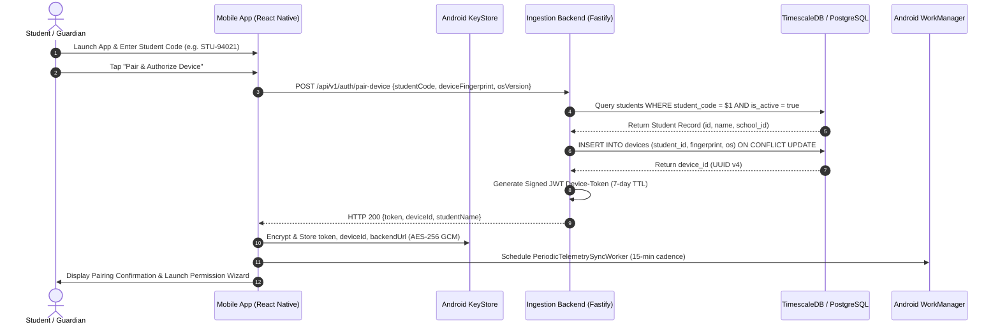
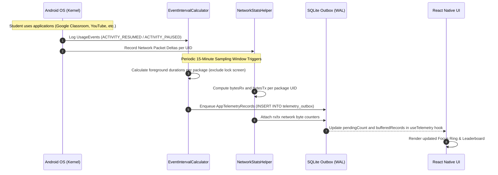
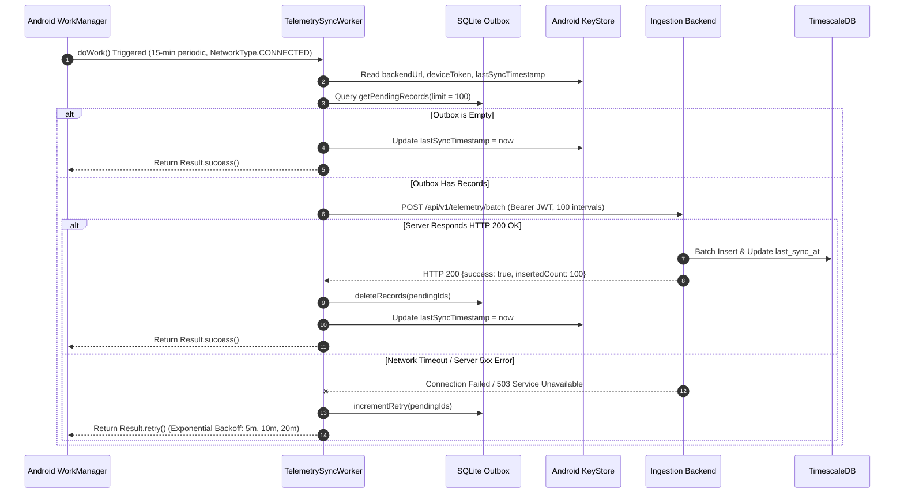
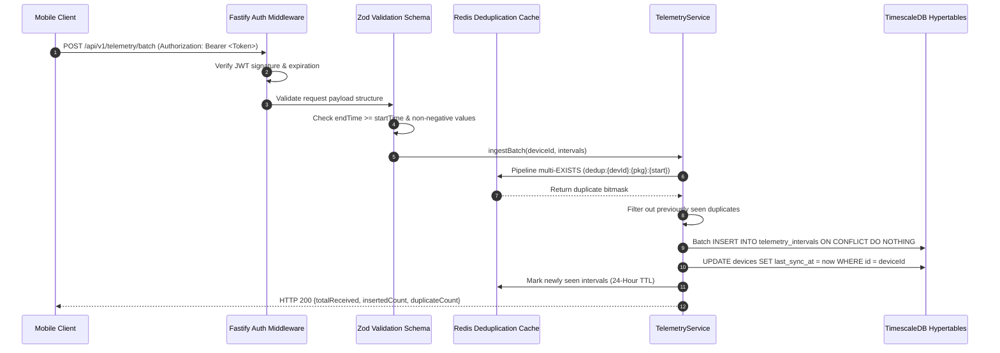
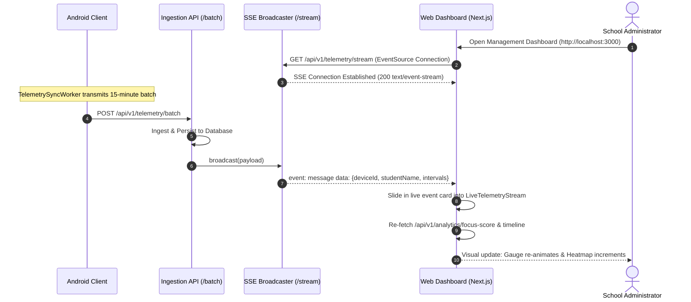
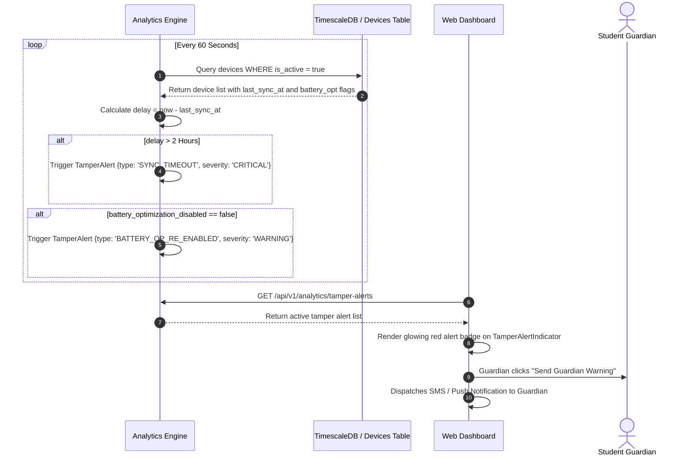

# 05. End-to-End System Workflows & Lifecycles

## 1. Overview

This document provides a comprehensive operational breakdown of the core workflows in the Aegis platform. Each workflow is illustrated with a sequence diagram and accompanied by step-by-step technical execution details.

---

## 2. Workflow 1: Student Device Enrollment & Initial Pairing

### Technical Details:
1. **Enrollment Code Input**: The student enters their code manually or opens a school pairing deep link (`telemetry://pair?code=STU-94021&url=https://...`).
2. **Device Fingerprint Extraction**: The app generates a hardware identifier combining Android build parameters (`Build.MANUFACTURER`, `Build.MODEL`, `Build.ID`).
3. **Hardware Keystore Storage**: Credentials are immediately handed over to `SecureStorageManager.kt` and encrypted via hardware-backed Android KeyStore keys.
4. **WorkManager Initialization**: `TelemetrySyncWorker.schedulePeriodicSync(context)` enqueues the 15-minute background synchronization job with `ExistingPeriodicWorkPolicy.UPDATE`.

---

## 3. Workflow 2: On-Device Interval Collection & Local Buffering

### Technical Details:
1. **Direct OS Querying**: Every 15 minutes (or on manual snapshot trigger), `UsageStatsManager.queryEvents(startTime, endTime)` is inspected.
2. **Foreground Focus Parsing**: `ACTIVITY_RESUMED` marks the start of an active interval, and `ACTIVITY_PAUSED` marks the conclusion.
3. **Lock Screen Compensation**: `KEYGUARD_SHOWN` and `SCREEN_NON_INTERACTIVE` events trigger immediate interval truncation so idle time is never counted.
4. **Local FIFO Enqueue**: Records are stored in Android SQLite WAL mode. Even if the phone immediately loses power, the intervals remain completely preserved.

---

## 4. Workflow 3: Background Sync via Android WorkManager

### Technical Details:
1. **Network Constraint**: The sync worker only fires when `NetworkType.CONNECTED` is satisfied, preventing unnecessary battery drain on offline devices.
2. **Atomic Ingestion Acknowledgement**: Outbox records are strictly deleted **after** the server returns `HTTP 200`.
3. **Exponential Backoff**: If transmission fails, `WorkManager` reschedules the attempt using `BackoffPolicy.EXPONENTIAL` (5 minutes base interval).

---

## 5. Workflow 4: Batch Ingestion, Validation, Deduplication & Storage

### Technical Details:
1. **Zod Schema Bounds Enforcement**: Ensures batches contain between 1 and 1000 items and rejects inverted timestamps.
2. **Redis Fast Pipeline**: Avoids database query overhead by dropping retransmissions directly in memory.
3. **Idempotent Insertion**: Uses PostgreSQL's `ON CONFLICT (device_id, package_name, start_time) DO NOTHING` to guarantee mathematical idempotency.

---

## 6. Workflow 5: Real-Time Telemetry Broadcasting to Dashboard

### Technical Details:
1. **Server-Sent Events (SSE)**: Provides low-overhead unidirectional event streaming without the complexity of bidirectional WebSockets.
2. **Reverse Proxy Compatibility**: Nginx configuration includes `proxy_buffering off` and `proxy_read_timeout 86400s` to ensure immediate push delivery without chunk buffering.

---

## 7. Workflow 6: Automated Tamper & Anomaly Alert Workflow

