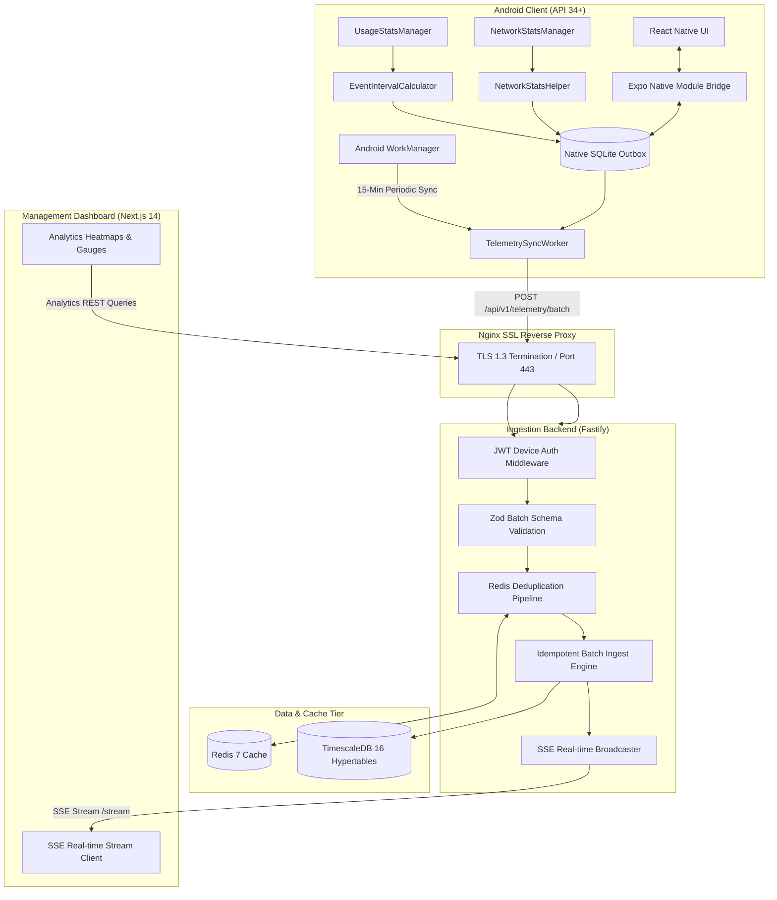

# Aegis Telemetry & Monitoring Platform — Technical Documentation

Welcome to the comprehensive technical documentation for the **Aegis Student Telemetry & Monitoring Platform**. This repository contains a production-grade, privacy-compliant, fault-tolerant telemetry and monitoring platform engineered for remote-learning student devices.

This documentation suite is organized into modular, detailed specifications located in the `documents/` directory:

---

## Documentation Index

| Document | Title | Description |
| :--- | :--- | :--- |
| **[01_ARCHITECTURE_AND_TOPOLOGY.md](./01_ARCHITECTURE_AND_TOPOLOGY.md)** | System Topology & Security Architecture | High-level topology, component matrix, Zero-Content Privacy Ledger, and end-to-end security model. |
| **[02_ANDROID_CLIENT_ENGINEERING.md](./02_ANDROID_CLIENT_ENGINEERING.md)** | Android Client Engineering & Native Module | Detailed analysis of the Android 14+ Kotlin native module, `UsageStatsManager`, `NetworkStatsManager`, `WorkManager`, Keystore encryption, and React Native UI. |
| **[03_INGESTION_BACKEND_AND_STORAGE.md](./03_INGESTION_BACKEND_AND_STORAGE.md)** | Ingestion Backend, Storage & Redis Pipeline | Deep dive into the Fastify TypeScript API, Redis deduplication pipeline, TimescaleDB hypertable schema, idempotent inserts, and complete API catalog. |
| **[04_ANALYTICS_AND_WEB_DASHBOARD.md](./04_ANALYTICS_AND_WEB_DASHBOARD.md)** | Analytics Engine & Web Dashboard | Mathematical formulas for the Daily Focus Score, 24-Hour Timeline Heatmap, tamper detection heuristics, and Next.js 14 visualization components. |
| **[05_END_TO_END_WORKFLOWS.md](./05_END_TO_END_WORKFLOWS.md)** | End-to-End System Workflows & Lifecycles | Complete lifecycle execution flows with Mermaid sequence diagrams: device pairing, background sync, server ingestion, SSE streaming, and tamper alerting. |
| **[06_DEPLOYMENT_OPERATIONS_AND_TESTING.md](./06_DEPLOYMENT_OPERATIONS_AND_TESTING.md)** | Deployment, Operations & Testing Runbook | Production Docker Compose orchestration, Nginx SSL proxy, APK/AAB build pipelines, health checks, and test runner execution. |

---

## Architectural Summary

---

## Core System Principles

1. **Zero-Content Telemetry**: Aegis monitors *how long* and *when* educational vs. distracting applications are utilized, as well as network byte quantities, without ever reading screen contents, keystrokes, personal messages, or cameras.
2. **Strict Idempotency & Fault Tolerance**: Through composite unique constraints `(device_id, package_name, start_time)` and Redis SHA-key deduplication, duplicate transmissions never corrupt or double-count screen time.
3. **Offline Resilience**: When devices lose network coverage, telemetry intervals are persisted inside an encrypted local SQLite outbox queue with exponential retry backoff.
4. **Sub-Millisecond Ingestion**: Node.js Fastify clustered runtime coupled with TimescaleDB hypertables enables ingestion rates exceeding thousands of interval batches per second.
